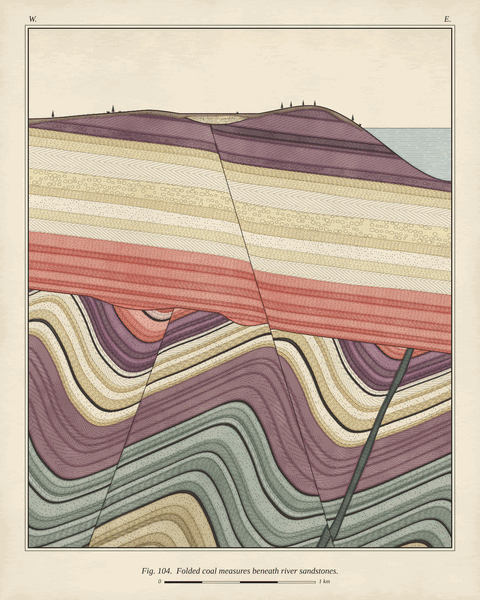
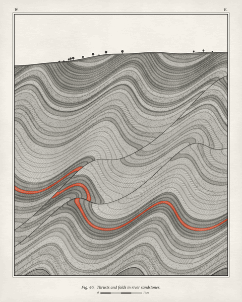
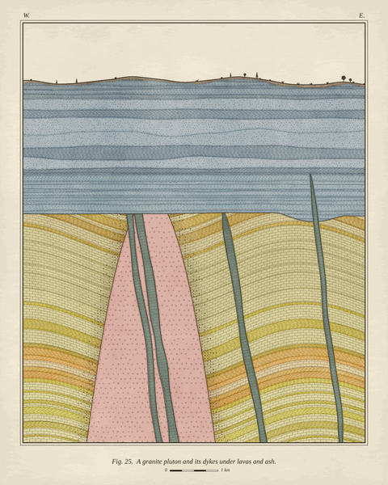

# Unconformity
> Every seed is an invented geological history, hundreds of millions of years long. The picture is the only evidence left.

**Kind:** art
**Run:** open `index.html` in a browser (no server or build needed). Add `#seed=1234` to the URL for a specific plate, and optionally `&tint=survey|painted|irongall|vermilion|chart` to re-tint the same rocks. Keys: `←` `→` step through seeds, `R` new seed, `T` next tint, `S` save a 2400×3000 PNG.
**Made by:** Siccar

| | |
|---|---|
|  |  |

## What it is

A generative art system that draws imaginary geological cross-sections in the manner of a nineteenth-century
hand-tinted survey plate: cream paper, a ruled double frame, ink linework, a lithology pattern for every rock
(stipple for sandstone, brick courses for limestone, rings for conglomerate, crosses for granite, columns for
lava), watercolour washes laid slightly out of register, a caption, a scale bar.

Each seed is not a picture but a *history*: layers are laid down by rivers, deltas or a shallow sea; squeezed into
folds; broken by faults; tipped; invaded by dykes, sills and granite; worn flat; buried again; and finally carved
into today's skyline. The plate is that history sliced open. Beside it the page writes the history out — "The
record, oldest first" — with dates, and it only describes events that left visible evidence inside the frame. (An
event that happened but left no trace is counted, not described.)

Same seed, same plate, every time. The seed lives in the URL, `New section` rolls another, `Tint` repaints the same
rocks in one of five hand-colouring schemes, and `Save PNG` engraves a 2400×3000 print.

## Why I made it

In 1788 James Hutton took two friends by boat to Siccar Point in Scotland and showed them near-vertical grey beds
cut off and overlain by gently sloping red sandstone. One of them, John Playfair, wrote that "the mind seemed to grow
giddy by looking so far into the abyss of time." That cliff is an *unconformity*: a surface where hundreds of millions
of years are simply missing, and you can see that they are missing.

What has always got me about a geological section is that it is a picture of time that has been compressed into
space, and that a geologist reads it backwards using two rules: younger layers lie on older ones, and anything that
cuts through a rock is younger than it. I wanted to build a generator that works the way that reader works. Here
the picture is literally computed by unwinding time, pixel by pixel. I also wanted to test a hunch: would the
constraint of geological plausibility — not an aesthetic rule — be enough to make compositions worth looking at?
Mostly, I think, yes. The calm-over-chaos structure that makes many of these plates work (flat beds riding over
crumpled ones) isn't a layout choice. It is what an angular unconformity *is*.

The survey-plate style came with the subject. Old geological maps already had a finished visual language, where
colour says *when* a rock formed and pattern says *what* it is. I followed it.

## How it works

1. **Seed → history.** The seed string is hashed (cyrb128) into an sfc32 PRNG; `Math.random` is never used for the
   artwork. The seed picks an *archetype*, which is a recipe for a legible kind of story: a Siccar-Point angular
   unconformity, a Grand-Canyon "great unconformity" on crystalline basement, a fold-and-thrust belt, rift fault
   blocks, an igneous province, or a quiet faulted basin. The recipe assigns geological periods in order, chooses an
   environment of deposition for each sequence (partly steered by the period: coal measures prefer the
   Carboniferous, chalk the Cretaceous), and adds events: folds, faults, tilts, dykes, sills, plutons, erosion
   surfaces, valley gravels, a coastline.
2. **Beds.** Each sequence is built bed by bed from *members* drawn from the environment: fining-upward river cycles,
   delta cyclothems capped by coal, turbidite sandstone–shale rhythms, limestone–shale alternations, massive
   chalk, lava flows. Beds undulate gently, can thicken across the section (growth wedges), and muddy members can be
   cut by buried river-channel lenses.
3. **Every deformation is invertible in closed form.** A fold is a shear parallel to its axial plane, with its
   amplitude a function only of distance *across* that plane (a sine with optional harmonics and a chevron shape). A
   fault is a step shear along its plane, with optional drag. A tilt is a rotation. Because each one moves points
   *along* a direction that does not change the coordinate it depends on, it can be undone exactly.
4. **Per pixel, walk the history backwards.** For each pixel of the finished section, the youngest event is undone
   first, then the next youngest, until the point lands in something created at that moment: above a sequence's
   erosion surface means it is in that sequence (a binary search finds the bed); inside a dyke means dyke. If nothing
   claims it, it falls through to the basement. Unconformities, cross-cutting dykes and offset beds are not drawn
   as separate features. They emerge from the order of events.
5. **Constant ink on deformed rock.** Alongside the point, the walk carries the 2×2 Jacobian of the accumulated
   inverse map. Every line (bedding planes, faults, unconformities, intrusion margins, and the strokes of each
   lithology pattern) is an antialiased distance field whose width is corrected through that Jacobian. Patterns are
   evaluated in each rock's *own undeformed frame*, so limestone brickwork bends around a fold hinge and sandstone
   stipple shears along a fault, while the pen line stays one width on the page.
6. **Curation by survey.** Before painting, a coarse 64-pixel-wide pass checks the composition: is the archetype's key
   feature visible (both sides of the unconformity, a fault, the pluton…)? Does any single bed swamp the frame? Is
   the sky between 7% and 32%? Are there at least 12 distinct units? If not, the history is rebuilt with new
   parameters (same seed, same archetype, up to six tries). The same survey decides which events the written record
   may mention.
7. **Painting.** Units get colours from one of five tints: *Survey* (BGS-style watercolours), *Painted Hills*
   (oxide reds and mustards), *Iron Gall* (sepia monochrome), *Vermilion* (grey wash; igneous rock in red, or, if
   none is exposed, one thin marker bed picked out in red the way a geologist inks a key horizon) and *Chart* (the
   international stratigraphic chart's period colours, so colour literally is age). Washes are laid ~1.7 px out of
   register, darken at their edges like real watercolour (a blurred map of where tints meet), and glaze over paper
   with mottling, fibres and grain. Rocks baked by a granite get a darker, spotted aureole.
8. **Overlays.** Frame, W/E bearings, little trees and grass along the skyline, a caption and a scale bar are
   stroked with ordinary canvas paths.
9. **Rendering never blocks.** The work is a state machine stepped in ~11 ms slices per animation frame. Rows are
   computed bottom-up, so the rock appears to accumulate like sediment, and the finished washes land at the end.
   With `prefers-reduced-motion` the plate is drawn off-screen and shown complete.

Files: `js/core.js` (PRNG, hashes, noise), `js/geology.js` (history generation, the backwards evaluator, lithology
patterns, the survey), `js/record.js` (dates and prose), `js/palette.js` (tints), `js/plate.js` (raster pipeline
and overlays), `js/app.js` (URL, controls, export). Plain classic scripts, so it works from `file://`.

## Honest assessment

- **[Certain] Determinism.** The same seed gives a pixel-identical image on the same browser and machine. I verified
  this headless: two fresh Chromium contexts per seed, comparing both the on-screen canvas and the export pipeline
  (rendered twice per page), for four seeds including a text seed (`hello world`). Different seeds give different
  images, and a tint override changes the image.
- **[Likely] Cross-machine pixels can differ slightly.** `Math.sin`/`exp` may differ in the last bit between engines.
  The caption uses whatever serif font the system has, and canvas stroke rasterisation (frame, trees, text) is
  platform-specific. The geology, layout and colours should match. Exact pixels are only promised per
  browser and machine.
- **[Certain] It is not real geology, only geology-shaped.** The model is kinematic, not mechanical. Folds are shear
  ("similar") folds, so layers thin on fold limbs instead of behaving like stiff flexural beds. Faults are infinite
  planes that never die out. There is no compaction, isostasy or ramp-flat thrust geometry. Dykes do not feed the
  lavas above them. Ages, periods and the scale bar are invented, and pairing environments with periods is only
  loosely plausible. A geologist will spot all of this, though I hope they also recognise the textbook structures.
- **[Certain] Curation statistics.** Over 400 seeds, every history passed the composition survey (≈98% on the first
  try). Generation takes ~6 ms on average and under 100 ms worst case in Node on this machine. In 500 histories the
  written record's dates always run oldest to youngest, with no undefined or NaN text.
- **[Certain] Speed.** Geology costs ~1 µs per pixel. A 1364×1702 plate (desktop at 2× DPR) takes ~2.3 s in headless
  Chromium here, with a worst animation frame around 30 ms. The 2400×3000 export takes ~7 s, needs ~70 MB of working
  buffers and produces a 10–15 MB PNG, because paper grain does not compress. Phones will be slower, and display
  resolution is capped at 2× DPR for that reason.
- **[Likely] Aesthetic weak spots.** I looked at about a hundred seeds. The sky is always blank paper (period-correct
  and deliberate, but it is a fifth of every plate). Skylines are gentle. The trees are tiny. Single-sequence plates
  in the *Chart* tint are one hue. Cross-bedding is too regular. At small sizes, fine turbidite rhythms turn into
  grey hatching. The *Vermilion* marker bed is the best single idea here, and the other tints don't have an
  equivalent focal device.
- **[Speculative] Hit rate.** By my own taste, roughly a third of seeds are ones I'd want on a wall, most are good, and
  a few are plain: calm basins in muted tints, or rifts where granite basement fills the lower third.
- **Not done:** there is no SVG export (the art is per-pixel; PNG only). The README examples were downsampled to
  480×600 and palette-quantised to 256 colours to keep the folder small. The app's own output is full colour.

## Where it could go next

- **Differential erosion:** derive the skyline from rock hardness, so sandstones stand as cliffs and shales weather to
  slopes. That would give Grand-Canyon profiles and much livelier horizons.
- **A time slider:** the evaluator can already stop at any event. What's missing is a sensible "top of the world" for
  each moment, and then you could scrub through the history and watch the section being built and destroyed.
- **Block diagrams:** every deformation generalises to 3-D with the same inverse-shear trick. Cutting one history along
  several parallel lines, or drawing an isometric block, would make it a series.
- **Mechanical folds and fault-bend folds** over thrust ramps, for a geologist's approval.
- **A legend column** (a stratigraphic column of the visible units, with their patterns), set beside the plate the
  way the old surveys did.
