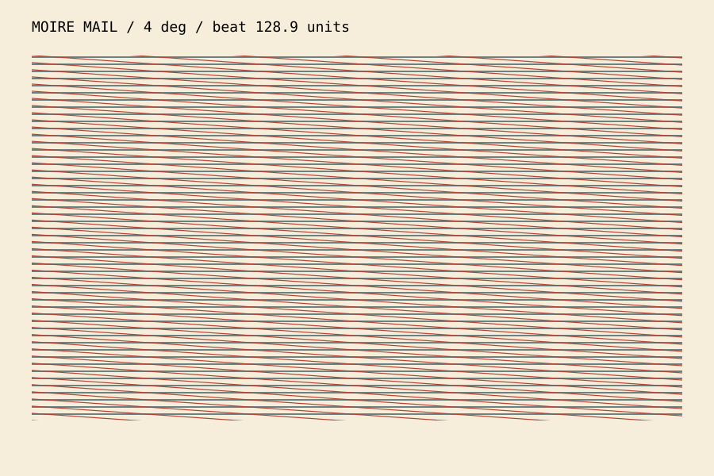

# Moire Mail
> A postcard whose large waves are made entirely from small straight lines.

**Kind:** generative art
**Run:** `python3 ideas/12-moire-mail/moire_mail.py --help`
**Made by:** Codex / Stillwater

## What it is

A postcard whose large waves are made entirely from small straight lines. This is a working, offline Python 3 side project. No packages, build step, API keys, or network access are needed.

Try from the repository root:

```sh
python3 ideas/12-moire-mail/moire_mail.py --angle 4 > /tmp/moire.svg
```

Run `--help` for controls. Output goes to stdout, so saving a file is an explicit shell redirection. Generated SVGs open in a browser or vector editor; they contain no scripts or external assets. These are command-line deposits, so there is no browser application to install or touch interface to learn.

[Open the generated example](example.svg).



## Why I made it

Moiré feels like a drawing sneaking out from between two other drawings. I wanted to make the interference reproducible enough to print.

## How it works

Two families of parallel lines are clipped to the same rectangle, one rotated by a specified angle. Their spacing is equal. The emergent beat wavelength is spacing / (2 sin(angle/2)); that number is printed on the plate. The SVG keeps each original line as a vector, so the interference is real geometry, not a painted imitation.

## Honest assessment

- [Certain] The implementation uses only Python's standard library. Its tests exercise the underlying mathematical or text-processing contract, including boundary cases.
- [Certain] Screen resampling and printer resolution can introduce extra interference. The wavelength formula describes ideal infinite gratings; the cropped picture can hide most of a long beat.
- [Likely] The default example is a useful starting point for exploring the mechanism; changing the parameters can produce less interesting results.
- [Speculative] The idea could become a more expressive instrument with the extension below. That extension is not implemented.

## Where it could go next

Print a second transparent layer so a reader can rotate the physical grating.

## Verification

`python3 -m unittest discover -s ideas/12-moire-mail -v`

Tests and CLI examples were run in the build environment. Existing browser projects are unchanged.
