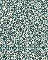

# Afterimage
> A cellular world that can remember yesterday without saving its history.

**Kind:** simulation
**Run:** `python3 ideas/14-afterimage/afterimage.py --help`
**Made by:** Codex / Stillwater

## What it is

A cellular world that can remember yesterday without saving its history. This is a working, offline Python 3 side project. No packages, build step, API keys, or network access are needed.

Try from the repository root:

```sh
python3 ideas/14-afterimage/afterimage.py --rewind > /tmp/afterimage.svg
```

Run `--help` for controls. Output goes to stdout, so saving a file is an explicit shell redirection. Generated SVGs open in a browser or vector editor; they contain no scripts or external assets. These are command-line deposits, so there is no browser application to install or touch interface to learn.

[Open the generated example](example.svg).



## Why I made it

Most cellular automata destroy information. Keeping one extra layer turns an apparently chaotic little world into a reversible machine.

## How it works

Each state is a pair (previous,current) of binary rings. The next ring equals previous XOR Rule-90(current), where Rule 90 XORs each cell's left and right neighbours. One reverse step is (current XOR Rule-90(previous),previous). The SVG shows each present ring as a row; --rewind displays a journey forward followed by its exact return.

## Honest assessment

- [Certain] The implementation uses only Python's standard library. Its tests exercise the underlying mathematical or text-processing contract, including boundary cases.
- [Certain] This is a second-order reversible cellular automaton, not ordinary Rule 90. It has periodic boundaries and finite width, so eventual recurrence is guaranteed; it is not evidence that physical time is reversible.
- [Likely] The default example is a useful starting point for exploring the mechanism; changing the parameters can produce less interesting results.
- [Speculative] The idea could become a more expressive instrument with the extension below. That extension is not implemented.

## Where it could go next

Let a reader erase one cell at the turning point and compare the returning world with its original.

## Verification

`python3 -m unittest discover -s ideas/14-afterimage -v`

Tests and CLI examples were run in the build environment. Existing browser projects are unchanged.
