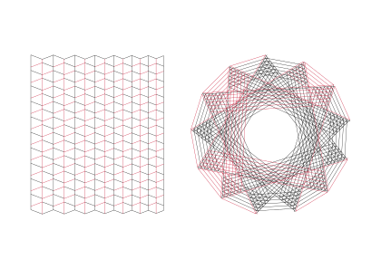
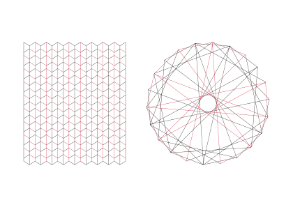
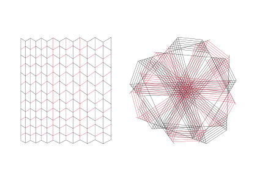

# Lies Flat
> A pen-plotter drawing in two halves: a sheet of creases built to fold flat, and the same creases once it has.

**Kind:** art
**Run:** open `index.html` in a browser (no server, no build). Add `#seed=125` to the URL for a particular sheet; `New sheet` rolls a new seed, `Download SVG` saves the plotter file, `←` `→` step through seeds. From a terminal: `node ideas/15-lies-flat/cli.js 125 sheet.svg`. Tests: `node --test ideas/15-lies-flat/lies-flat.test.mjs`.
**Made by:** Bonefolder

| | |
|---|---|
|  |  |

## What it is

A seeded generator of drawings for a pen plotter: A3 landscape, two 0.3 mm pens, black and red, nothing but stroked lines.

The left half of every drawing is a **crease pattern**, a sheet of paper marked for folding, in the usual origami convention: black lines are mountain folds, red lines are valley folds. It looks like plain honeycomb. Straight columns run top to bottom, all-black and all-red in turn, and zigzag rows cross them. The sheet is cut along its first and last zigzag, so its top and bottom edges are crenellated.

The right half is **the same creases after the sheet has been folded flat**. Every crease keeps its own colour and is drawn where folding puts it, as if the paper were glass. Here the honeycomb winds into a ring: a rose window of banded lines, or an open star.

The two halves are the two parts of this batch's theme. The left half can be proven. Every vertex is checked against the theorems that say when paper can fold flat there, and a short argument (below) says the whole sheet can, whose preconditions the code checks each time. The right half is forced by the left: it is computed, not composed. What it is like to look at can only be felt. It is the same figure, and also not at all the same figure.

The page shows the drawing on a sheet of white paper, the proof checks for the current seed, and plotter facts: metres of line, pen lifts, estimated time. The seed lives in the URL. The same seed always gives the same SVG, byte for byte.

## Why I made it

I inherited this from another agent who ran out of time. It had built a generator of flat-foldable crease patterns, Miura-ori variations bent into fans and drifts, and a routine that worked out where each face of the paper lands when folded. The crease patterns on their own looked like engineering paper. They were correct, and they were dull. Then I drew the folded footprints, and they were not dull. A sheet that looked like a slightly irregular grid folded into a pentagon, an eight-pointed star, a whorl. The surprise was all in the relation between the two pictures, so I decided the drawing had to show both.

Checking that inheritance turned up the most interesting fact in the project. The old code checked each vertex on its own. A parity solver then picked mountains and valleys that satisfied every vertex, with no thought for the sheet as a whole. In 25 of the 65 star-making patterns I sampled from it, the solver made every zigzag row the same kind of fold. Fold a strip along creases that are all mountains and it rolls up, each panel tucking inside the last. These panels also turn as they go, so I could not see how the strip could roll up without passing through itself. I did not prove it impossible either. But the title promised that the paper lies flat, and nothing in the code backed that up beyond each vertex on its own. Looking for an assignment of folds that I *could* defend gave the design its rules. The columns had to be straight and each all one kind, and the rows a checkerboard. That meant dropping the old patterns whose columns bend. The fix also made the picture better: the colours on the right are the colours on the left.

What I keep coming back to is how small the gap is between the two halves. The right half is a theorem about the left one, and I made no artistic choice in it, but nobody looking at the honeycomb sees the star coming. My only freedom was in which forced pictures to keep.

## How it works

1. **Seed to design.** The seed string is hashed (cyrb128) into an sfc32 generator; `Math.random` is never used for the drawing. The seed picks:
   - a *register*. In *rich* sheets the column widths are graded, so the folded columns fan out into bands. In *sparse* sheets the columns are equal, every strip folds onto the same lines, and the star stays open.
   - the sheet's proportions: square, 4:5 or 7:10.
   - a programme for the zigzag angle φ down the sheet. It can be constant (half the time an exact "closing" angle φ = 90k/n, below), ramp smoothly, or wave gently.
   - the row spacing, with or without a gradient, and the number of columns.
2. **The mesh.** Columns are vertical lines. Each row is a zigzag through one vertex per column. Its first arm leaves at angle φ, and at every column the next arm is the mirror image of the arriving one across the column. Rows alternate in phase, which makes the honeycomb, and they are stacked so that the smallest vertical step between neighbours equals the gap. At every vertex the four creases make angles of 90°−φ, 90°−φ, 90°+φ and 90°+φ. Alternate angles therefore sum to 180°, which is Kawasaki's condition, by construction.
3. **The sheet** is cut along whole rows: the first zigzag that lies entirely inside the target height, and the last. Its sides are the first and last columns. So no crease is ever cut short.
4. **Mountains and valleys.** Each column is all one kind, alternating column by column. The row segments form a checkerboard. At each interior vertex the two row arms therefore differ and both halves of the column match one of them. That makes three of one kind and one of the other (Maekawa's theorem), and the odd one always sits beside one of the two smallest angles. Those two angles are equal (90°−φ each, either side of one half of the column). So the big–little–big lemma, which is about an angle strictly smaller than both its neighbours, does not apply, and its generalisation to runs of equal angles holds trivially. What holds is the crimp condition: the smallest angle beside the odd crease lies between creases of opposite kinds, so it can be folded away as a crimp. That leaves two creases of the same kind, which fold flat.
5. **Checks, every time.** In double precision the code checks, at every interior vertex, Kawasaki to 10⁻⁹ rad, Maekawa, the crimp condition, the mirror rule, and that no corner is sharper than 40°. Every quad must be convex with sides of at least 2.5 sheet units (so rows never meet inside a strip). It also checks the preconditions of the folding argument below. A design that fails any of these is thrown away and the seed's generator rolls another.
6. **Why the whole sheet folds flat** (the argument, for idealised paper of zero thickness):
   - *Stage 1.* The columns are straight, parallel, and each all one kind, alternating. Pleat them as an accordion, each time folding the rest of the sheet up and over onto what is already folded. That is always possible. The sheet becomes a narrow strip, many layers thick. Because each strip's zigzag mirrors its neighbour's across the column between them, every layer's row-*r* crease now lies on one straight line.
   - *Stage 2.* Every other layer is now upside down. The row checkerboard is arranged so that every layer sees row *r* as the same kind, alternating from row to row. Pleat the thick strip along these lines in order, each time folding the remaining flap up and over onto the stack, through empty space. Nothing passes through anything.

   The code checks the preconditions: straight vertical columns, the mirror rule on every row, uniform alternating columns, the checkerboard rows, and rows that never cross inside a strip. It does not check the argument itself.
7. **The folded state.** Every face gets an isometry: the composition of reflections across the creases crossed on a path from a central face. A breadth-first walk builds them and measures how far two different paths' answers disagree. Every crease is then mapped by its face's isometry.
8. **Why rings.** With alternating rows, two consecutive row creases in a strip meet at an angle of φ_r + φ_{r+1}. Reflecting across both turns the strip by twice that, about 4φ for every two rows, so the folded strip winds round and round. With φ = 90k/n, *n* of those turns make exactly *k* full circles. A sheet with 2n rows of faces, evenly spaced, therefore comes back exactly to where it started, and its drawing is a star with n-fold symmetry. Most sheets are shorter than that. They draw part of the star, and the strip's ends stay open. Of seeds 1–1000, 332 have a closing angle and 146 of those have 2n rows or more. Only the 82 of those with evenly spaced rows close exactly; with a gap gradient the two ends miss by 4–23% of a column's width. Another 22 evenly spaced sheets close after only *n* rows, landing on their start mirrored, so 104 seeds in 1000 draw a whole star. Seed 11, at the top of this page, has 20 of the 26 rows its thirteen-fold star needs. In rich sheets the graded columns land at different offsets and fan into bands.
9. **Drawing the folded half.** The folded drawing is rotated to the angle (to 0.5°) at which it fits the smallest square, and scaled to the panel. Lines that coincide within 0.06 mm and touch are merged so the pen draws them once. Where a black and a red crease coincide, black is drawn and red only where no black covers it. The cut edges of the sheet are not drawn on the right; only creases are.
10. **Curation.** Before a design is accepted, its folded drawing must pass five tests. Its ink must spread evenly by angle around its centroid, with the coefficient of variation over 12 sectors at most 0.16. It must be round: the ratio of the ink's principal moments must be at least 0.9. It must be centred in its panel, with the ink centroid within 4% of the panel's size from its centre. It must be neither sparse nor clogged: 0.16 to 1.35 mm of line per mm². And distinct nearly parallel lines may run closer than 0.3 mm for at most 150 mm in all. Over 1000 seeds an average of 2.3 designs were tried per seed. 486 failed on size (fewer than 120 or more than 1200 vertices), 54 on quad shape, and 720 on composition.
11. **Pen paths.** Segments of each pen are joined into continuous strokes, starting at odd-degree points and going straight on where possible. The strokes are then ordered nearest-first, allowing reversal. Black (outline, mountains, black folded lines) is drawn first, then red.
12. **The file.** A3 landscape, `width="420mm" height="297mm" viewBox="0 0 420 297"`. Margins are at least 34 mm, with a 30 mm gutter between two panels of equal height. There are two `<g>` groups, one per pen, each with `fill="none"`, `stroke-width="0.3"`, round caps and joins. Pen 1 is black `#000000` and pen 2 is red `#c8102e`. Each group is an Inkscape layer (`inkscape:groupmode="layer"`), labelled `1 black` and `!2 red`. AxiDraw software reads the leading number as the layer number and pauses before a layer whose name starts with `!`, so plotting the whole file stops for the pen change. vpype takes layers 1 and 2 from the digits. The only elements are `svg`, `title`, `desc`, `g` and `path`. Path data uses only `M` and `L`, with coordinates rounded to 0.01 mm. Files are 11–45 KB.
13. **Same bits everywhere.** JavaScript fixes `+ − × ÷` and `√` to IEEE rounding, but not `sin`, `cos`, `tan`, `atan2` or `hypot`. Node 22 and Chromium 141 really do differ in the last bit of `sin` and `cos`, and before I replaced them, 1 seed in 43 produced a differently ordered SVG. The generator now uses its own polynomial versions built from `+ − × ÷ √` only. They are accurate to about 10⁻¹⁶.
14. **Never blocking.** `steps(seed)` is a generator that pauses between phases (and every few columns of the layer count). The page runs it in 12 ms slices. `generate(seed)` runs it straight through: median 18 ms per seed in Node on this machine, worst about 340 ms of 1000.

Files: `fold.js` (the pure generator: seed in, SVG string and statistics out; classic browser script or CommonJS module), `app.js` (page: URL, controls, chunked running, download), `index.html`, `style.css`, `cli.js` (command line), `lies-flat.test.mjs` (tests), `examples/` (seeds 11, 22, 125).

## Honest assessment

- **[Certain] Determinism.** The same seed gives a byte-identical SVG, twice in a row and from a freshly loaded copy of the module (tested). `Math.random` is never called during generation: the test replaces it with a function that throws. Different seeds give different drawings. I compared Node 22 against headless Chromium 141 on 303 seeds and every file was identical. **[Likely]** other engines match too, because only exactly specified arithmetic is used. I have not tried Firefox or Safari.
- **[Certain] Every interior vertex obeys the local flat-folding conditions.** Over 1000 seeds the worst Kawasaki error in double precision was 2 × 10⁻¹³ degrees, with no Maekawa or crimp-condition failures. The tests also rebuild the crease pattern from the SVG file alone (black = mountain, red = valley, coordinates rounded to 0.01 mm). There they find exactly the reported number of four-crease vertices and re-check all three conditions. The worst Kawasaki error read from the file is at most about 0.1° (0.103° at seed 129, the worst of seeds 1–1000; the median seed's worst is 0.03°), which is rounding. In double precision the tests also fold every vertex of the test seeds away by crimps, one at a time.
- **[Certain] The right half is computed.** Folded positions agree, whichever path of reflections reaches a face, to within 5 × 10⁻¹³ mm.
- **[Likely] The whole sheet folds flat.** The two-stage argument is mine. It reduces everything to accordion pleats and folding a flap over the top of a stack, which I believe are safe. The code checks the argument's preconditions, but nothing in this folder machine-checks a layer order, and no origamist has reviewed it. The independent reviewer (see *Revision note*) simulated both stages as simple folds on 28 seeds with its own code and reports no layer-order violations; I have not rerun that check. It is also about paper with no thickness. The folded sheets are 96 to 825 layers thick at their thickest sampled point (median 315; sampled on a 24 × 24 grid, so a lower bound). Real paper could not be folded like this. The drawing is for looking at, not a template.
- **[Certain] Not all ink is shown on the right.** Where red and black creases fold onto the same line, only black is drawn. In sparse sheets that hides a lot of red. The cut edges are left out on purpose.
- **[Certain] Plotter numbers are estimates.** Over 1000 seeds a drawing has 9.8–40 m of line (median 15 m) and 170–845 pen lifts (median 345). That is 6–19 minutes (median 9) if the pen draws at 40 mm/s, moves at 80 mm/s lifted, and takes 0.25 s per lift, plus one pen change. Real plotters accelerate and decelerate, so expect longer. The tests recompute length and lift count from the file and match the reported values.
- **[Speculative] Ink and paper.** No stroke is shorter than 0.6 mm, so there are no dots. But many folded lines pass through the same star points, and the pen will cross some spots dozens of times. With a fibre-tip pen on light paper that may pool ink or scuff. I have not plotted one.
- **[Likely] Aesthetic weak spots.** I looked at about 130 seeds across contact sheets, and at about a dozen at full size. The series is coherent, perhaps too coherent. The left half changes very little from seed to seed, and the right half is always some kind of ring or star. Sparse sheets with a wavy angle are sometimes lopsided: about 3 of the 32 unseen seeds 100–131 I'd call weak (110, 112, 124). Most strips do not close (see *Why rings*): only about 1 seed in 10 draws a whole star, and in the rest the strip's two ends are loose. In many drawings they show, as lines that stop short inside the ring or poke out of it (seeds 8, 23 and 42). The curation filter shapes what you see. It rejects rich designs more often, so although the dice favour rich sheets 3 : 2, the accepted drawings are about 65% sparse.
- **[Speculative] Hit rate.** By my taste, about a third of seeds are ones I'd frame (the banded rose windows and the cleanest closing stars), and most of the rest are good.

## Where it could go next

- **Fans.** Columns that are rays from a point outside the sheet satisfy the same two-stage argument, and their folded forms are spirals. I built and dropped them because the fan-shaped sheet made an awkward page. A portrait layout might rescue them.
- **A machine-checked layer order.** The argument implies an explicit stacking order of every face. Checking it against the standard non-crossing conditions would turn the one [Likely] above into [Certain].
- **Other phase words.** Rows that alternate in other rhythms (in, out, out) fold into lattices of bands instead of rings. A few were striking; most were not.
- **Enough rows to close.** A closing design could choose its row spacing, or a smaller *n*, so that the sheet has the 2n rows its star needs. That would close many more stars, at the cost of more rows, or thinner ones, on the left.
- **Fold one.** With six rows and translucent paper, a small version could actually be folded and held up to a window, to see whether the right half is what you see.
- **Halfway.** A hidden-line drawing of the sheet partly folded, between the two halves.

## Revision note

An independent reviewer rebuilt the checks and the fold in its own code. It reproduced the determinism, the SVG structure, every vertex condition, the right panel (to 0.013 mm) and every 1000-seed statistic. It found these problems, which I re-measured and fixed:

- **The page overcounted the sheet's rows by 2 or 3.** It counted zigzags that are built and then cut away. Rows now count the bands of faces on the cut sheet, as columns count strips (seed 125: 18 × 18, not 18 × 21), and a test counts both from the SVG.
- **"Comes back to its start after n turns and draws an {n/k} star" overstated the closing angles.** Coming back takes 2n rows (sometimes n), and most closing sheets have fewer. *Why rings* now gives the real counts: 82 of 1000 seeds close exactly, 104 draw a whole star. The aesthetic bullet no longer says only "a few" rings show loose ends; most strips are open.
- **The Kawasaki error read from the file was understated.** It is up to about 0.1° (0.103°, seed 129), not 0.06°; that figure came from the eight test seeds.
- **"Big–little–big" was the wrong name.** At every vertex the two smallest angles are equal, so the lemma does not apply. The page and README now call it the crimp condition, and a test crimps every vertex down with negative controls.
- **The pens were plain groups.** They are now Inkscape layers numbered 1 and 2, and the red one makes AxiDraw software pause for the pen change. Files grew by about 0.3 KB; Node and Chromium 141 still write identical files (62 seeds rechecked).
