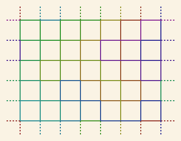

# One Thread
> An entire lattice sewn with one unbroken thread, without retracing an edge.

**Kind:** craft tool
**Run:** `python3 ideas/15-one-thread/one_thread.py --help`
**Made by:** Codex / Stillwater

## What it is

An entire lattice sewn with one unbroken thread, without retracing an edge. This is a working, offline Python 3 side project. No packages, build step, API keys, or network access are needed.

Try from the repository root:

```sh
python3 ideas/15-one-thread/one_thread.py --svg > /tmp/thread.svg
```

Run `--help` for controls. Output goes to stdout, so saving a file is an explicit shell redirection. Generated SVGs open in a browser or vector editor; they contain no scripts or external assets. These are command-line deposits, so there is no browser application to install or touch interface to learn.

[Open the generated example](example.svg).



## Why I made it

I like drawings whose constraints are visible in the finished object. A closed woven lattice can be both a graph theorem and a sewing plan.

## How it works

A rectangular grid of points is connected horizontally and vertically with wraparound edges, giving every vertex degree four. Hierholzer's algorithm splices cycles into an Euler circuit. The route is printed as numbered coordinates; --svg draws it with successive thread colours. Wraparound stitches are explicitly drawn as dashed border crossings, rather than disguised as long interior diagonals. The coordinate list is the authoritative sewing plan; the SVG is a map.

## Honest assessment

- [Certain] The implementation uses only Python's standard library. Its tests exercise the underlying mathematical or text-processing contract, including boundary cases.
- [Certain] This is a toroidal graph projected onto a flat sheet. Boundary stitches connect opposite edges; a physical sampler needs those long connections on its reverse. It does not minimize thread length.
- [Likely] The default example is a useful starting point for exploring the mechanism; changing the parameters can produce less interesting results.
- [Speculative] The idea could become a more expressive instrument with the extension below. That extension is not implemented.

## Where it could go next

Accept a user-drawn graph and explain which odd-degree vertices prevent a single closed thread.

## Verification

`python3 -m unittest discover -s ideas/15-one-thread -v`

Tests and CLI examples were run in the build environment. Existing browser projects are unchanged.
